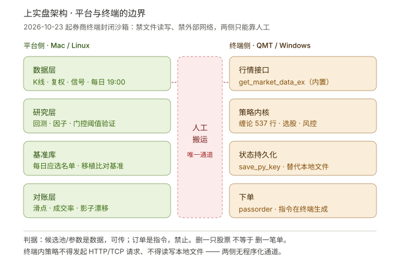
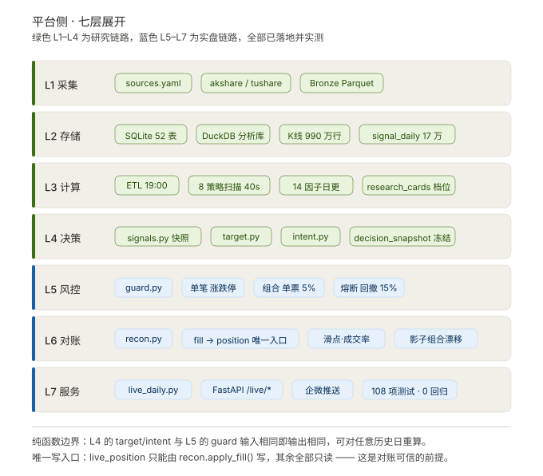
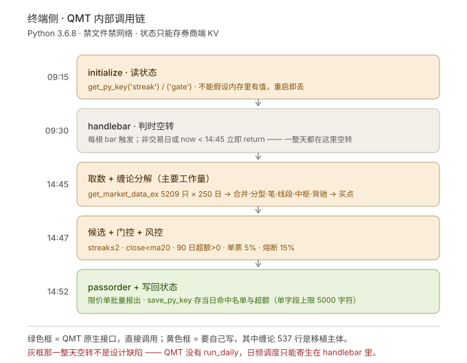

# 上实盘技术方案（2026-10-29）

> 回答两个问题：① QMT 现在还能不能用；② 在现行监管下，这套系统怎么真正落到实盘。
> 前置文档：`LIVE-TRADING-DESIGN.md`（架构）、`LIVE-SYSTEM-BUILD.md`（施工与验收）

## 架构总览



绿色 = 平台侧已就绪并实测运行；黄色 = 终端侧待移植；中间红色虚线 = 唯一通道，且只能人工。
**两侧之间不存在程序化数据通道**——这是 2026-10-23 之后的新约束，也是本方案 §1 要推翻旧设计的原因。

### 平台侧七层展开



七层全部对应到具体文件与数字。两条不变量写在图底：**输入相同即输出相同**（纯函数，可对任意历史日重算）、
**`live_position` 只能由 `recon.apply_fill()` 写**（唯一写入口，是对账可信的前提）。

### 终端侧调用链



绿色是 QMT 原生接口（`get_market_data_ex` / `passorder` / `save_py_key`），黄色要自己写。
灰色那一整天空转不是设计缺陷——**QMT 没有 `run_daily`**，日频调度只能寄生在 `handlebar` 里判时间。


---

## 0. 先回答：QMT 还能不能用

**能，但形态变了。而且 MiniQMT 已经死了。**

### 时间线（本轮收紧的完整链条）

| 时间 | 事件 |
|---|---|
| 2026-07 | **MiniQMT 停新增**（xtquant 独立接口被界定为「外接系统」），存量分批清理 |
| 2026-08-28 | 中证协 + 中基协《证券公司交易信息系统接入管理规范（试行）》（中证协发〔2026〕181号） |
| 2026-09 | 券商组建专项工作组，排查、关停权限、清退存量 |
| **2026-10-09** | 券商通知：QMT 内置 Python **关闭文件读写 + 关闭外部网络连接**（HTTP/TCP/UDP、MySQL/Redis/SQLite 全禁），取消登录页「独立交易」入口 |
| **2026-10-23** | 上述升级完成 |
| 2026-11（预计） | 第一阶段整改落地完成 |

### 三套终端现状

| | 完整版 QMT | PTrade | TdxQuant（通达信） |
|---|---|---|---|
| 运行位置 | 本地客户端（Windows） | 券商云端 | 本地 IDE |
| Python 版本 | 3.6.8（旧） | 白名单沙箱 | 3.7–3.14 |
| 文件读写 | ❌ 10-23 起禁止 | ❌ 禁 | ✅ 本地 |
| 外部网络 | ❌ 10-23 起禁止 | ❌ 禁出站 | ✅ |
| 状态持久化 | `save_py_key`/`get_py_key`（券商服务端） | `g` 变量 pickle | 本地文件 |
| 关机是否停 | 停 | **不停** | 停 |
| 现状 | 可用但封闭 | 相对未受冲击 | 受清理影响小 |
| 实盘委托 | 需白名单 + 报备 | 需白名单 + 报备 | 同样需券商授权 |

**判断**：
- ❌ **MiniQMT / xtquant**：不要考虑了，7 月就停新增，存量在清理
- ⚠️ **完整版 QMT**：还能跑，但必须是「纯内置策略」——数据只用 QMT 接口、下单只用 `passorder`、不碰文件不联网
- ✅ **PTrade**：本轮最稳，但沙箱同样禁外网禁本地文件
- 🆕 **TdxQuant**：本地开发自由度高，是新出现的可选路径，但实盘委托仍需券商授权 + 报备

---

## 1. 这条政策打死了一个设计（必须承认）

我 10-28 给的方案里有一条：**平台出候选池 API → 券商终端内策略用 HTTP 拉取**。

**这条现在走不通了。**

- QMT：10-23 起策略内任何 HTTP/TCP/UDP 连接被禁
- PTrade：沙箱严格限制出站网络，不能 `requests`，不能连外部数据库

也就是说：**平台和终端之间不允许存在任何程序化数据通道**。

这不是"换个协议"能绕的，是沙箱层面的封堵。所以下面的方案全部按「终端完全自包含」重做。

> 唯一残留的合规通道是券商自己提供的「研究区导入 / 文件上传」入口（各家不同，需向客户经理确认）。但那是人工上传，不是自动拉取。

---

## 2. 三条落地路径

### 路径 A：全自包含 QMT（推荐）

策略完整搬进 QMT，每天在本地跑全市场扫描 → 选股 → 下单，全闭环。

| 项 | 评估 |
|---|---|
| 工作量 | 中。缠论引擎 537 行纯 Python（只依赖 `dataclasses`），选股逻辑 328 行 |
| 算力 | 本地 CPU，全市场 5209 只 × 250 日 ≈ 20–40 秒（平台实测值） |
| 状态 | `save_py_key` / `get_py_key` 存券商服务端（单字段 5000 字符，够存 90 天门控） |
| 硬件 | 需要一台常开的 Windows 机器（Mac 用虚拟机或小主机） |
| 风险 | 沙箱可能继续收紧；策略在终端内是黑盒，平台无法实时监控 |

### 路径 B：简化策略上 PTrade

只搬一两个策略，规则简化，云端托管。

| 项 | 评估 |
|---|---|
| 工作量 | 中。但全市场缠论扫描在云端可能超时（PTrade 算力不如本地） |
| 优点 | 不用常开电脑，关机照跑 |
| 缺点 | 必须放弃「8 策略全市场扫描」，退化成 1-2 个策略，**等于换了个策略，要重新验证** |

### 路径 C：候选池人工上传（过渡）

平台出候选池 → 人工贴进终端策略参数 → 终端下单。

| 项 | 评估 |
|---|---|
| 工作量 | 小，今天就能做 |
| 合规 | 候选池是数据，可以传（删一只股票 ≠ 删一笔订单） |
| 缺点 | 每天 1 次人工，不算全自动 |

---

## 3. 为什么推荐路径 A

三个理由，按重要性排：

**① 移植成本比想象的低。** 我原本以为缠论要重写，实际查了代码：`chanlun.py` 537 行，**只 import 了 `dataclasses`（标准库）**，没有任何第三方依赖。要改的只有 3 处 Python 3.10+ 语法（`from __future__ import annotations`、`X | None`），降到 3.6.8 是机械劳动。

**② 全市场扫描必须用本地算力。** 每天要算 5209 只 × 250 根 K 线的缠论分解（合并→分型→笔→线段→中枢→背驰→买卖点），平台在 M 系列 Mac 上实测 20–40 秒。PTrade 云端沙箱算力弱、还有执行时长限制，这个量级有超时风险。QMT 跑在你自己机器上，没有这个约束。

**③ QMT 关了文件，但留了 `save_py_key`。** 这是关键：策略需要记住「昨天有哪些信号」（算 streak）、需要记住「近 90 日候选池超额」（算门控）。文件读写被禁了，但这两个值可以存券商服务端的 KV 里。单字段 5000 字符，90 天数据够用。

---

## 4. 移植的具体设计

### 4.1 策略在 QMT 内的结构

```
QMT 内置策略（单文件，Python 3.6.8 兼容）
├── chanlun_core()        缠论引擎（chanlun.py 移植，537 行，纯 Python）
├── high_tight_flag()     涨停缩量（约 20 行）
├── calc_ma20_streak()    算 ma20 + 连续信号天数
├── gate_check()          PIT 门控（读 save_py_key 存的历史超额）
├── select_targets()      候选判定 + 排序 + 目标持仓
├── risk_check()          三层风控（复用平台 guard.py 的逻辑，砍掉依赖）
└── place_orders()        passorder 下单
```

### 4.2 关键接口映射

| 用途 | 平台（现在） | QMT（移植后） |
|---|---|---|
| 取日线 | `kline_daily` + `adj_factor_daily` | `ContextInfo.get_market_data_ex`（`dividend_type='back'`） |
| 取昨收 | SQL | 同上，取 T-1 最后一根 |
| 当前持仓 | `live_position` | `get_trade_detail_data(account, 'stock', 'position')` |
| 可用资金 | `live_equity.cash` | 同上，`'account'` |
| 下单 | 人工 | `passorder(opType, orderType, account, code, prType, price, volume)` |
| 状态持久化 | SQLite | `save_py_key` / `get_py_key` |
| 日志 | `data/logs/*.log` | QMT 内置日志（不能写文件） |
| 推送 | 企微 webhook | ❌ 禁用联网，只能看 QMT 界面 |

### 4.3 三个移植时必踩的坑

**① 复权口径。** 平台的 `signal_actions.close` 是后复权（`close × adj_factor`），QMT 的 `dividend_type='back'` 也是后复权，但**基准日不同**（QMT 以最新日为基准，平台的 `adj_factor` 以某固定日为基准）。候选判定用 `close < ma20` 是比值，不受影响；但**下单价格必须用不复权价**（`dividend_type='none'`），否则会挂出天价单。

**② streak 会丢。** 平台里 streak 是查 `signal_daily` 算连续天数；QMT 里没有这张表，必须每天把当日命中名单写进 `save_py_key`，次日读出来比对。**策略重启后 `initialize` 先读 KV，不能假设内存里有值。**

**③ 定时触发。** QMT 只有 `handlebar(ContextInfo)`，没有 `run_daily`。日频策略要在 `handlebar` 里自己判断「今天是不是目标日、当前是不是 14:50」。平台里那套「15:35 算信号」的逻辑，在 QMT 里要么改成盘中算（用当日快照），要么用 `run_time` 定时（需确认券商版本支持）。

**这一条必须在模拟盘里实测。** 有实战案例：改写后回测一笔成交都没有，就是因为定时没触发。

### 4.4 语法降级清单（3.10 → 3.6.8）

| 现在 | 改成 |
|---|---|
| `from __future__ import annotations` | 删掉，类型注解改用字符串 |
| `x: float \| None` | `x: Optional[float]` |
| `dict[str, Position]` | `Dict[str, Position]`（`from typing import Dict`） |
| `@dataclass(frozen=True)` | 3.6 支持，保留 |
| f-string 嵌套引号（3.12+） | 拆成变量 |

---

## 5. 验证：三层，缺一不可

移植完最大的风险不是跑不起来，是**「跑起来了但选股和回测不一致」**——那等于换了个策略在跑实盘。

| 层 | 怎么做 | 判据 |
|---|---|---|
| **① 选股一致性** | 同一区间（比如 10-08 ~ 10-28 共 15 个交易日），QMT 逐日选出的股票 vs 平台 `signal_daily` 逐日比对 | **逐日名单完全一致**。不一致就停，查复权/参数/数据源 |
| **② 模拟盘一个完整周期** | QMT 模拟账号跑满 10 个交易日（fresh_ma 的最长持有期） | 调仓日真的触发、委托真的发出、止损真的生效 |
| **③ 小资金实盘** | 目标规模的 10–20%，跑 20 个交易日 | 成交率 > 90%，滑点中位数 < 0.3%，与影子组合偏离 < 2pp |

第 ① 层是最容易被跳过、也是唯一能证明「移植没走样」的一步。平台这边已经有全部历史信号，比对脚本半天能写。

---

## 6. 平台的新定位（重要变化）

终端封闭之后，平台不能再实时参与实盘。角色变成三个：

| 角色 | 做什么 |
|---|---|
| **研究端** | 因子挖掘、策略回测、参数寻优、门控阈值验证——这些终端做不了 |
| **基准库** | 保存「每天应该选出什么」的完整历史，作为终端选股一致性的比对基准 |
| **事后对账** | 人工导出 QMT 成交记录 → 平台导入 → 算滑点/成交率/漂移（`live_fill` + `recon.py` 已就绪） |

**已经写好的 L3-L7 没有白费**：决策逻辑、风控规则、对账口径全部可以直接复用（QMT 里的 `risk_check` 就是 `guard.py` 的移植），只是「数据流方向」从「平台→终端」变成了「平台→（人工）→终端→（人工）→平台」。

---

## 7. 上线节奏

| 阶段 | 动作 | 判据 |
|---|---|---|
| **第 0 周（本周）** | 打 2–3 家券商电话，问四件事（见下） | 定通道与券商 |
| 第 1 周 | 开户、风险测评 C4、入金达标、录白名单、签风险揭示书、**完成程序化报备** | 报备通过（1–3 工作日） |
| 第 2 周 | 缠论引擎移植 + 语法降级 + 选股一致性验证 | 15 个交易日名单逐日一致 |
| 第 3 周 | 模拟盘跑满 10 个交易日 | 调仓/委托/止损都真实触发 |
| 第 4–14 周 | 小资金实盘（目标规模 10–20%） | 成交率、滑点、漂移三项达标 |
| 第 15 周起 | 按**执行质量**（不是收益）决定是否加仓 | 加仓即触发变更报备 |

### 本周打电话要问清的四件事

1. **「你们家的完整版 QMT，内置 Python 是不是 10-23 之后禁了文件读写和网络？」**——确认已升级，别拿到旧版
2. **「QMT 和 PTrade 能不能同时开？」**——两个都开，互为备份（沙箱可能继续收紧）
3. **「20 日日均资产门槛多少，能录量化白名单吗，报备多久？」**
4. **「有没有官方的研究区导入 / 参数下发通道？」**——这是唯一可能恢复「平台→终端」数据流的合法路径

---

## 8. 风险清单

| # | 风险 | 影响 | 应对 |
|---|---|---|---|
| 1 | QMT 沙箱继续收紧（下一步可能禁 `passorder` 之外的接口） | 策略失效 | 同时开 PTrade 做备份 |
| 2 | 策略在终端内是黑盒，平台看不到运行状态 | 出问题难以及时发现 | 每天人工看 QMT 界面 + 事后对账 |
| 3 | 移植后选股漂移 | 实盘跑的不是回测的策略 | 三层验证第①层，逐日比对 |
| 4 | 常开 Windows 机器故障 | 错过调仓 | 日频策略有 16 小时窗口，可次日补 |
| 5 | `save_py_key` 5000 字符不够 | 门控历史被截断 | 只存近 30 日，或降精度存 |
| 6 | 策略本身在回撤（10 月 -9.3%） | 亏钱 | 这是策略问题，不是工程问题，见 `LIVE-TRADING-DESIGN.md` §2.3 |

---

## 9. 一句话总结

**QMT 没死，但它变成了一个封闭沙箱：数据只能从它自己的接口进，单只能从 `passorder` 出，中间不许和外界有任何文件或网络往来。**

这意味着「平台算好、终端执行」的自动化链路在技术上被切断了。想让策略跑起来，只有两条路：**要么把策略完整搬进终端（路径 A），要么接受每天一次人工搬运（路径 C）**。

我推荐 A，因为缠论引擎的移植成本比预想低得多——537 行纯 Python，零第三方依赖。

---

*监管信息依据 2026-10-29 公开检索（含券商系统通知截图转载），具体执行口径以开户券商正式通知为准。本文不构成法律意见。*
