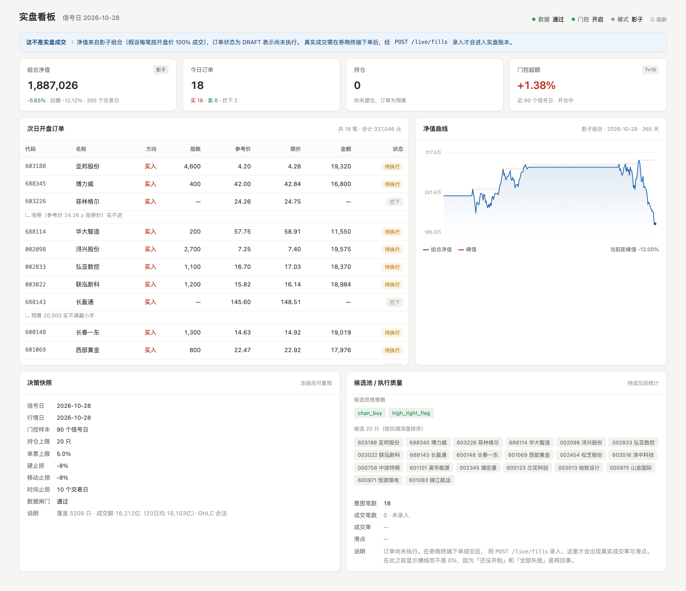

# 实盘系统施工手册

> 2026-10-28 首版。对应设计：`LIVE-TRADING-DESIGN.md`
> 当前状态：**L3-L7 全链路已落地**（决策 / 意图 / 风控 / 对账 / API），108 项测试通过。

---

## 1. 已经能跑什么

一条命令，从数据校验到订单清单落库：

```bash
cd backend
PYTHONPATH=$(pwd) python scripts/live_daily.py --capital 400000
```

输出：数据闸门 → 门控状态 → 候选 → 订单清单（代码/名称/方向/股数/限价/金额）→ 落库。

加 `--dry-run` 只打印不写库；`--date 2026-10-27` 可补算历史某天；`--rank code` 切回回测的字典序。

### 2026-10-28 实跑结果

```
【数据闸门】2026-10-28 → 通过
  覆盖 5209 只 · 成交额 16,212亿（20日均 16,100亿）· OHLC 合法
【决策】门控=开启（近 90 个信号日超额 +1.38%）
  候选 20 只 · 卖出 0 只 · 买入 20 只
  enabled 策略: chan_buy, high_tight_flag
卖 0 笔 · 买 19 笔 356,454 元 · 拦下 1 笔（688143 长盈通 145.6 元买不满 200 股）
预估现金：400,000 → 43,546
```

---

## 2. 代码结构

```
backend/app/live/
  __init__.py      包说明与 STRATEGY_KEY
  target.py        L3 组合意图：单日决策纯函数（decide_close / apply_open / mark / replay）
  signals.py       信号装载：DB → 不可变快照（含 PIT 门控超额）
  intent.py        L4 订单意图：target − actual → 可执行清单（含科创板 200 股、买不起拦截）
backend/scripts/
  live_daily.py    每日流水线入口（数据闸门 → 决策 → 意图 → 落库）
backend/tests/
  test_live_target.py  等价性验收（5 项）
```

五张表（`models.py` 末尾）：`live_position` / `live_order_intent` /
`live_decision_snapshot` / `live_fill` / `live_equity`。

---

## 3. 等价性验收（本系统最重要的测试）

**命题**：用「单日决策 + 开盘执行 + 收盘估值」重演历史，必须与
`portfolio_fresh.run_portfolio_fresh` 的全历史重演结果完全一致。

**真实数据结果**（265 个信号日）：

| 指标 | 重演引擎 | 单日函数 | 一致 |
|---|---|---|---|
| 期末净值 | 1,887,026.44 | 1,887,026.44 | ✅ |
| 收益率 | -5.65% | -5.65% | ✅ |
| 最大回撤 | -12.12% | -12.12% | ✅ |
| 成交笔数 | 411 | 411 | ✅ |
| 门控开启天数 | 98 | 98 | ✅ |
| 净值逐日 | 265 天 | 265 天 | **0 天差异** |
| 末 50 笔明细 | — | — | **0 笔差异** |
| 期末持仓 | 15 只 | 15 只 | ✅ |

合成数据另有 5 项 pytest（`test_live_target.py`）：门控开关、止损出场、
时间止损、排序可注入。全套 85 项通过。

**为什么这条必须先做**：拆分只要有 1 处口径漂移（成本、成交价、风控顺序、
门控 PIT 切片），实盘就系统性偏离回测，且事后无法归因——分不清是执行问题
还是策略问题。所以拆完先证明「拆完还等于原来」，再谈加功能。

---

## 4. 口径备忘（踩过的坑，写下来免得再踩）

| 项 | 事实 | 影响 |
|---|---|---|
| `signal_actions.close` | **后复权价** = `kline.close × adj_factor`（海尔智家 19.47×44.998=876.11） | 下单限价必须用 `kline_daily.close`，否则挂天价废单 |
| `kline_daily.amount` | 单位**千元**（茅台 518.7 万千元 = 51.9 亿） | 全市场日成交 16,212 亿，别当 16 亿看 |
| `kline_daily.volume` | 单位**手**（×100 股） | 换手/流动性估算要注意 |
| 科创板 688 | 最小 **200 股** | 2 万预算买 57.75 元的票只能 200 股 = 1.16 万，仓位 2.9% 而非 5% |
| 当日 K 线入库时点 | 实测 08:00 就写了当日数据（早于开盘） | 不能拿 `trade_date==today` 判数据就绪，必须走 `check_data` 闸门 |

---

## 5. 还没做的（按优先级）

### ✅ 已完成 · L5 风控（`app/live/guard.py`）

三层，纯函数（可对历史任意一天重算结论）：

| 层 | 规则 | 动作 |
|---|---|---|
| 单笔 | 超出涨跌停范围→判脏数据；落在涨停区→买不进；跌停→卖不出；无持仓卖出→拒 | 拒单 |
| 组合 | 单票 ≤5%、持仓 ≤20、单行业 ≤25%、现金 ≥3%、单日换手 ≤40% | 截断到额度 |
| 熔断 | 回撤 -15% 停新开（不拦卖出）；单日亏损 -3% 停全部 | 全局暂停 |

**能截断就不拒绝**：单票超限减到上限、资金不足减到整手，只有减到 0 才拒。
理由：日频少买一手比整天不动更接近目标组合。

涨跌停按板块区分（ST 5% / 主板 10% / 创业板科创板 20% / 北交所 30%），
替代原来 `risk.py` 的 ±10% 一刀切。

有一处必须豁免：**初始建仓日不受 40% 换手限制**。空仓到满仓天然 100% 换手，
实测 40 万只建到 9 只就被卡死（"预算 37 元"就是这么来的）。

### ✅ 已完成 · L7 对账（`app/live/recon.py`）

- `apply_fill()` 是 `live_position` 的**唯一写入口**，其他任何地方只读
- 卖出无持仓 → 抛 ValueError（对账异常必须炸出来，不能静默吞）
- `import_fills_csv()` 兼容券商对账单列名，按 (日期,代码,方向,数量,价格) 查重
- `reconcile()` 产出滑点（均值/中位/最差）、成交率、未成交明细
- `mark_equity()` 记净值并与影子组合（`portfolio_exp_state`）比 `divergence_pct`

### ✅ 已完成 · API（`app/routers/live_ops.py`）

已挂载到 `/api/v1/live/*`：

| 接口 | 用途 |
|---|---|
| `GET /live/candidates` | **候选池（数据）**，供券商终端内策略拉取 |
| `GET /live/intents` | 当日订单意图（人看） |
| `GET /live/positions` | 实际持仓 |
| `GET /live/equity` | 净值 + 影子对照 |
| `GET /live/recon?date=` | 执行质量 |
| `POST /live/fills` | 录入成交（唯一写持仓入口） |

**本模块不提供任何下单能力**。旧的 `routers/live.py`（单笔下单 demo）仍然不启用。

⚠️ `candidates` 里同时返回 `close`（后复权，仅用于排序参考）和 `close_raw`（未复权，
可交易价格）。终端必须用 `close_raw` 或自己取实时价算股数——用复权价会买出天量。

### ✅ 已完成 · 实盘看板（`web/public/live.html`）

访问 **http://127.0.0.1:8000/live.html**（单文件，原生 JS，无构建、无外部依赖）



页面结构：

| 区块 | 内容 | 数据源 |
|---|---|---|
| 顶部状态 | 数据闸门 / 门控 / 模式 | `/live/candidates` |
| 四个 KPI | 净值、今日订单、持仓、门控超额 | `/live/shadow` + `/live/intents` |
| 次日开盘订单 | 代码/名称/方向/股数/限价/金额/状态，被拦的展开原因 | `/live/intents` |
| 净值曲线 | 净值 + 峰值虚线，标注当前距峰值 | `/live/shadow` |
| 决策快照 | 参数、门控、数据闸门说明 | `/live/candidates` |
| 候选池 / 执行质量 | 候选明细（按回调深度）、成交率与滑点 | `/live/candidates` `/live/recon` |

三条刻意的设计，都有原因：

1. **顶部固定一条蓝色横幅**：「这不是实盘成交，净值来自影子组合」。因为实盘未开始时，
   页面上所有数字都来自「假设每笔按开盘价成交」的重演——不加这句，看到 +12% 会误以为已经赚到手。
2. **成交率显示横线而不是 0%**。「还没开始」和「全部失败」是两回事，混淆会让人误判执行质量。
3. **被拦的订单不隐藏**。涨停买不进、预算买不满，这些是要在次日前处理掉的信息，
   藏起来等于把问题留到亏钱之后才发现。

页面每 60 秒自动刷新，也可点右上角手动刷新。

改完 `web/public/live.html` 后需要同步到 `dist`：
```bash
cp web/public/live.html web/dist/live.html     # 或 npm run build
```

### P1 · 推送与告警

信 → 企微（复用 `services/mailer.py`）。三类必推：数据闸门失败、风控拦截、
流水线未按时跑。

### P1 · API + 页面

`GET /api/v1/live/intents?date=` 出清单；前端一个「今日订单」页，可打印/导出 CSV。

### P2 · 调度

`live_daily.py` 挂到每日 15:35（收盘后、ETL 之前——本策略只用日线收盘价，
不必等 19:00 因子）。注意：`orchestrator` 的 daily scheduler 实测**从未触发过**
（`research_runs` 里 `trigger='scheduler'` 0 条），这块要一并修 + 加未触发告警。

### P2 · 排序改造的验证

`--rank pullback` 已实现（按 `close/ma20` 回调深度），但**还没验证它是否真的更好**。
需要：同区间跑 `code` vs `pullback` 两版，比值、比回撤、比换手。若不显著更好，
就用 `code` —— 至少它和现有回测数字对得上。

---

## 6. 每天怎么操作（Phase 3 人工执行）

| 时点 | 动作 | 谁做 |
|---|---|---|
| 15:35 | `live_daily.py --capital <实际本金>` | 定时/手动 |
| 15:40 | 看清单，检查门控与被拦项 | 老刘 |
| 次日 09:15-09:25 | 按清单挂限价单（集合竞价） | 老刘 |
| 次日 09:35 | 录入成交（或导对账单） | 老刘 |
| 次日 15:35 | 对账 + 出次日清单 | 脚本 |

---

*本手册随代码演进。口径与验收结论以实际运行输出为准，不以文档文字为准。*
